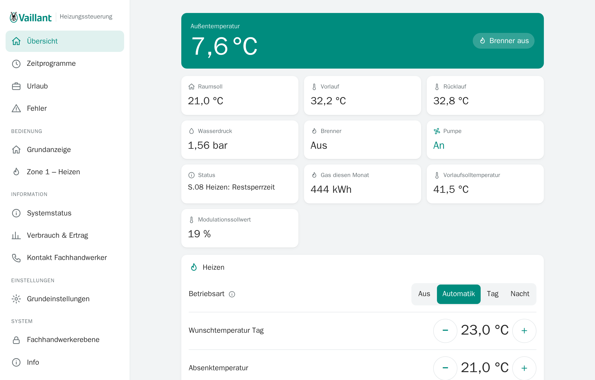
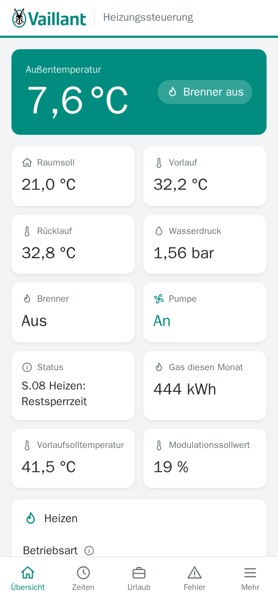
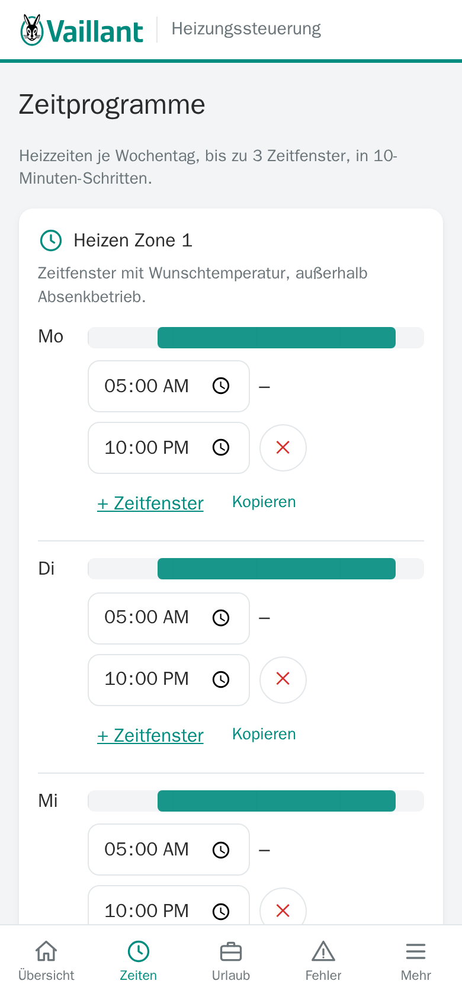
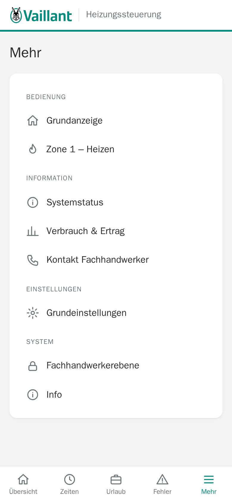
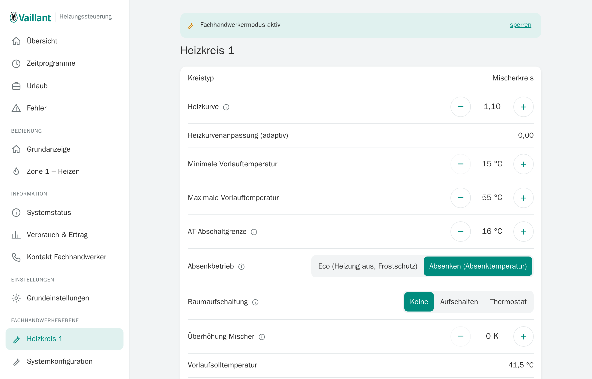

# Vaillant Heizungssteuerung

Weboberfläche für Vaillant-Heizungen mit **multiMATIC VRC 700** Regler und Vaillant-Gastherme, angebunden über
[ebusd](https://github.com/john30/ebusd). Alles, was am Display von Regler und Therme einstellbar ist, geht
damit auch im Browser – am Handy wie am Desktop, auf Deutsch, ohne Cloud.

<p align="center">
  
</p>
<p align="center">
  
  
  
</p>

> Kein offizielles Vaillant-Produkt. Vaillant, multiMATIC und ecoTEC sind Marken der Vaillant GmbH.
> Nutzung auf eigene Gefahr – falsche Einstellungen in der Fachhandwerkerebene können die Anlage beschädigen.

## Funktionen

- **Übersicht**: Außentemperatur, Raumsoll, Vor- und Rücklauf, Wasserdruck, Brenner, Pumpe, Statuscode
  (S.xx im Klartext), Gasverbrauch; Betriebsart, Wunsch- und Absenktemperatur direkt änderbar.
- **Schnellwahl** wie am Regler: Party, 1 Tag außer Haus, 1 Tag zu Hause, Stoßlüften, Quick Veto,
  Warmwasser einmalig laden.
- **Zeitprogramme**: Wochenplan je Zone, Warmwasser, Zirkulation, Kühlen, Lüftung; bis zu 3 Zeitfenster pro Tag
  in 10-Minuten-Schritten, Tage kopieren.
- **Urlaub**: Abwesenheit und Urlaubstemperatur, systemweit und je Zone.
- **Benutzermenü des VRC 700**: Zonen, Warmwasser, Kühlung, Lüftung, Systemstatus, Verbrauch & Ertrag,
  Kontakt Fachhandwerker, Grundeinstellungen wie Uhrzeit und Datum.
- **Fehler**: aktuelle Fehler und Fehlerhistorie von Regler und Therme mit deutschem Klartext (F.xx);
  defekte oder fehlende Fühler werden als Fühlerfehler angezeigt.
- **Fachhandwerkerebene** (Code `17`): Heizkurve, Vorlauf min./max., AT-Abschaltgrenze, Absenkbetrieb,
  Raumaufschaltung, Systemkonfiguration, Diagnosecodes der Therme (d.xx), Live-Werte und Statistik.
  Jede Änderung muss bestätigt werden.
- **Konfigurations-Export**: unter *Info* alle aktuellen Einstellungen plus die Rohwerte sämtlicher
  ebusd-Nachrichten als JSON herunterladen (dauert ca. 1 Minute).
- Nicht vorhandene Anlagenteile (Zone 2/3, Warmwasser, Kühlung, Lüftung) werden automatisch ausgeblendet.

<p align="center">
  
</p>

## Kompatibilität

Die Oberfläche spricht die ebusd-Schaltkreise `700` (Regler) und `bai` (Therme) an.

| Gerät | Status |
|---|---|
| **multiMATIC VRC 700** (eBUS-Kennung `70000`) | vollständig |
| **Gasthermen mit `bai`-Schaltkreis**: ecoCOMPACT, ecoTEC (plus/pro/exclusiv), auroCOMPACT, atmoCOMPACT, icoVIT, ecoVIT, ecoCRAFT | Bedienung vollständig; einzelne Diagnosecodes fehlen je nach Gerätefamilie |
| Zone 2/3 über Mischermodul VR 61 / VR 70 / VR 71 | Zonenbedienung ja (läuft über den VRC 700), Daten des Moduls selbst nicht |
| sensoCOMFORT VRC 720 | nein (andere Nachrichten) |
| calorMATIC VRC 470/450/430, VRT-Raumthermostate, sensoHOME | nein |
| Wärmepumpen aroTHERM / flexoTHERM (`hmu`) | nein |

Getestet mit ecoCOMPACT (HW 9602) und VRC 700 (SW 0614) an ebusd 26.1. Baugleiche Regler anderer Marken der
Vaillant Group mit derselben eBUS-Kennung sollten funktionieren, sind aber nicht getestet. Werte, die eine Therme
nicht kennt, zeigt die UI als „Kein Wert“ an; der Rest funktioniert weiter.

Über eBUS **nicht** erreichbar und daher nicht in der UI: Sprache, Displayhelligkeit, Temperatur-Offsets des
VRC 700, Prüfprogramme P.xx der Therme. **Bewusst gesperrt**: Werksreset (d.96), Gerätekennung (d.93),
Lüfter-Offsets (d.50/51), Energiezähler, Installateur-Code, Systemschema.

## Voraussetzungen

1. **eBUS-Adapter** am eBUS der Heizung, z. B. der [ebusd-Adapter v5](https://adapter.ebusd.eu/)
   (WLAN, Ethernet oder USB).
2. **ebusd** (getestet mit 26.1), per TCP auf Port `8888` erreichbar, mit den Vaillant-Definitionen im
   **CSV-Format** aus [`ebusd-configuration`](https://github.com/john30/ebusd-configuration), Ordner
   `archived/en`:
   ```bash
   git clone https://github.com/john30/ebusd-configuration /opt/ebusd-configuration
   # /etc/default/ebusd
   EBUSD_OPTS="--device=ens:192.168.1.50:9999 --configpath=/opt/ebusd-configuration/archived/en --accesslevel=* --port=8888"
   ```
   Mit der Standard-Konfiguration von ebusd (Download vom CDN) heißen einige Nachrichten anders; dann fehlen
   unter anderem die Zeitprogramme.
   `--accesslevel=*` braucht es nur, um Werte der Fachhandwerkerebene (Diagnosecodes der Therme) zu ändern;
   ohne den Parameter bleiben sie lesbar.
3. **Docker** (oder das einzelne Go-Binary) auf einem Rechner, der ebusd erreicht, gern derselbe Raspberry Pi.
   Images gibt es für `amd64`, `arm64` und `arm/v7` (Raspberry Pi 2 und neuer).

## Installation

```yaml
# docker-compose.yml
services:
  heizung:
    image: ghcr.io/l480/vaillant-ui:latest
    restart: unless-stopped
    ports:
      - "80:80"
    environment:
      EBUSD_ADDR: host.docker.internal:8888
      # ALLOWED_HOSTS: heizung.example.org
    extra_hosts:
      - "host.docker.internal:host-gateway"
    read_only: true
    cap_drop: [ALL]
    security_opt: ["no-new-privileges:true"]
```

```bash
docker compose up -d
```

Danach im Browser `http://<IP-des-Rechners>/` öffnen. Auf dem Handy lässt sich die Seite über „Zum
Home-Bildschirm“ wie eine App ablegen.

| Variable | Standard | Bedeutung |
|---|---|---|
| `EBUSD_ADDR` | `host.docker.internal:8888` | Adresse und Port von ebusd |
| `LISTEN` | `:80` | Adresse und Port der Weboberfläche |
| `READONLY` | – | `1` sperrt alle Änderungen (reine Anzeige) |
| `ALLOWED_HOSTS` | – | Hostnamen, unter denen die UI erreichbar ist (kommagetrennt), zusätzlich zu IP-Adressen und `localhost` |
| `WEB_DIR` | – | UI aus einem Ordner statt aus dem Binary laden (Entwicklung) |

## Sicherheit

Die Oberfläche hat **keine Anmeldung**: Wer sie erreicht, kann die Heizung steuern. Betreibe sie nur im Heimnetz
oder hinter einem Reverse-Proxy mit Anmeldung (z. B. Authelia, Cloudflare Access). Für den Zugriff über einen
Hostnamen muss dieser in `ALLOWED_HOSTS` stehen. Anfragen über unbekannte Hostnamen (DNS-Rebinding) und
Schreibzugriffe von fremden Webseiten (CSRF) werden abgewiesen. Der Code `17` für die Fachhandwerkerebene ist wie
am Gerät nur eine Bediensperre, kein Zugriffsschutz.

Schreibbar sind ausschließlich Parameter aus dem Katalog (`internal/catalog`), jeweils mit Prüfung von Bereich,
Schrittweite und erlaubten Werten. Nach jedem Schreiben wird der Wert von der Heizung zurückgelesen.

## API

Die UI nutzt eine JSON-API, die sich auch für eigene Automationen eignet:

| Endpunkt | |
|---|---|
| `GET /api/meta` | Version, erkannte Geräte, vorhandene Anlagenteile |
| `GET /api/catalog` | alle Parameter mit Bezeichnung, Einheit, Grenzen, Schreibbarkeit |
| `GET /api/values?ids=700.z1DayTemp,bai.FlowTemp[&fresh=1]` | aktuelle Werte |
| `PUT /api/values/{id}` mit `{"value": …}` | Wert schreiben |
| `GET /api/errors` | aktuelle Fehler und Historie |
| `GET /api/dump` | Konfigurations-Export (JSON-Download) |
| `GET /healthz` | Health-Check |

Einfache Endpunkte, z. B. für Homebridge: `GET /status` (Heizung an = `1`), `GET /pump-status`,
`POST /on`, `/off`, `/auto`, `/party`, `/ventilation`.

## Entwicklung

Go 1.27, keine externen Abhängigkeiten. Die UI (`web/`) ist reines HTML/CSS/JavaScript ohne Build-Schritt und wird
ins Binary eingebettet.

```bash
go test ./...
go run ./cmd/fakeebusd &        # simuliertes ebusd mit echten Beispielwerten aus e2e/fixtures
EBUSD_ADDR=127.0.0.1:8888 LISTEN=:8098 WEB_DIR=web go run .
```

Browser-Tests (Playwright) und Screenshots laufen gegen das simulierte ebusd, **nie gegen eine echte Heizung**:

```bash
python3 e2e/e2e.py http://127.0.0.1:8098
python3 e2e/shots.py http://127.0.0.1:8098 docs/screenshots
```

Releases entstehen über ein Tag `vX.Y.Z`: Die Pipeline baut das Multi-Arch-Image, signiert es mit cosign und legt
das GitHub-Release an.

Danke an [john30](https://github.com/john30) für ebusd und die Vaillant-Nachrichtendefinitionen, aus denen auch die
Beschreibungen der Parameter stammen.

## Lizenz

[MIT](LICENSE)
